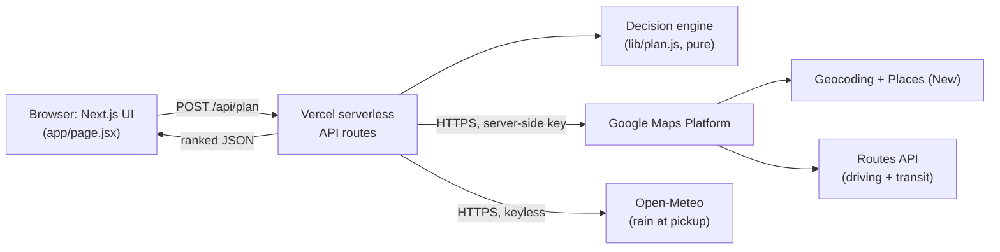
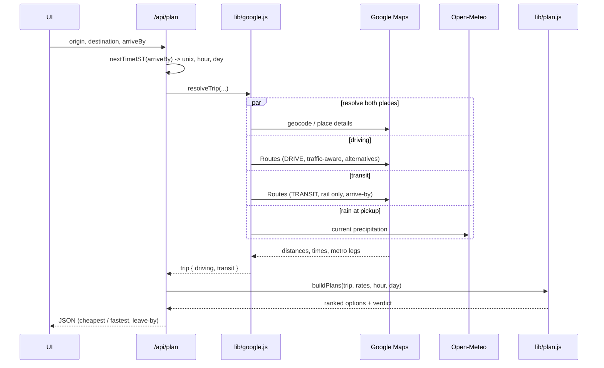

# FareWise Architecture

How two addresses and a time become a ranked cab / auto / metro answer.

FareWise has no login and no database. It is a stateless Next.js app: the browser sends a trip, serverless API routes gather live data from Google and Open-Meteo, a pure fare engine ranks the options, and the ranked result comes back as JSON. The Google key never leaves the server.

## System overview



## Request flow: `/api/plan`

A single "Find my best option" runs this sequence. The three Google lookups (places, driving, transit) fire together, not one after another.



## The decision engine (`lib/plan.js`)

Pure functions, no UI and no network, so it is unit-tested on its own (`test/plan.test.mjs`).

For each trip it builds up to three options and ranks them:

- **Cab, door to door.** A base fare plus a per-km rate, shown as a low-to-high range: the low end is the calm-conditions price, the high end leaves room for surge, since real app surge is not public.
- **Auto, door to door.** Bangalore meter rates, but short hops are floored to what an app auto actually charges, since the bare meter undershoots a 2 km ride. Shown as a range too: the low end holds the calm price day or night, and the high end widens late at night, since app autos are demand-priced rather than paying a fixed night surcharge.
- **Metro + auto.** Metro fare from the distance bands (fixed, it never surges), plus the access legs: an auto to and from the station, or a free walk when a station is within ~800 m. Multi-line trips show each leg and the interchange.

Three live signals shift the cab and auto ranges (never the fixed metro fare): the driving time uses Google's predicted traffic for the arrive-by time (and live traffic when that is near-now); late night widens the high end; and live rain at the pickup, from Open-Meteo, leans the whole range up with a flag, since rain is a strong surge driver. None of these claim a precise surge price. They bracket it.

It then flags the **cheapest** and the **fastest**, computes a **leave-by** time from the arrive-by target and the door-to-door minutes, and writes a one-line **verdict** (for example, take the metro when it is clearly cheaper and barely slower, or skip it when the access autos cancel the saving). When no metro route applies, it says so instead of dropping the option silently.

## Live data sources

| API | Used for | Where |
| --- | --- | --- |
| Geocoding | Resolve a typed address to a point, biased to Bengaluru | `lib/google.js` |
| Places API (New) | Autocomplete suggestions, and the exact point for a picked suggestion | `app/api/suggest`, `lib/google.js` |
| Routes API (DRIVE) | Traffic-aware driving distance and time, with alternative routes | `lib/google.js` |
| Routes API (TRANSIT) | Metro route, stations, and interchanges, timed to arrive by the deadline | `lib/google.js` |
| Open-Meteo | Current rain at the pickup, free and keyless; drives the rain lean | `lib/google.js` |

## Calls per plan

One "Find my best option" makes at most four Google calls (two place lookups, one driving Routes call, one transit Routes call) plus one keyless Open-Meteo call for rain, which runs in parallel with the driving lookup. Typing in an address box adds one Places autocomplete call per debounced burst of keystrokes, proxied through `/api/suggest` so the key stays server-side.

## Component map

```
app/
  page.jsx            UI: address autocomplete, time picker, result cards, light/dark toggle
  globals.css         theme tokens (light = auto-yellow, dark = ink-amber) and component styles
  api/
    plan/route.js     POST: IST time math, calls resolveTrip, runs the engine, returns ranked plans
    suggest/route.js  Places autocomplete proxy (keeps the Google key off the browser)
lib/
  google.js           live data: geocode, place details, Routes (driving + transit), Open-Meteo rain
  plan.js             pure decision engine: fares, ranking, verdict (no UI, no network)
test/
  plan.test.mjs       unit tests for the engine
```
