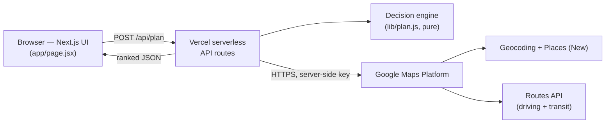
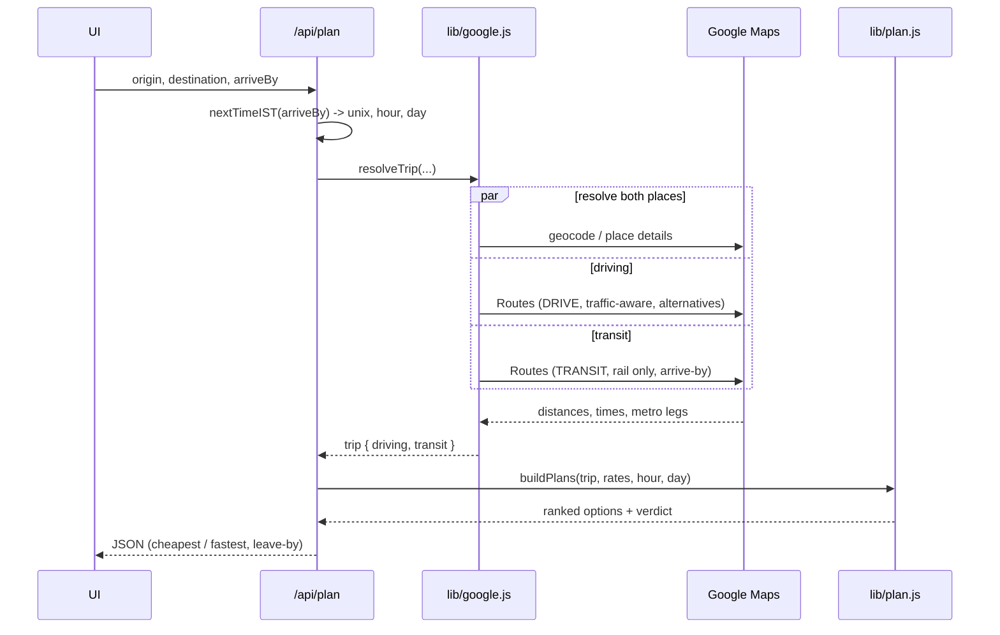

# FareWise — Architecture

How two addresses and a time become a ranked cab / auto / metro answer.

FareWise has no login and no database. It is a stateless Next.js app: the browser sends a trip, serverless API routes gather live data from Google, a pure fare engine ranks the options, and the ranked result comes back as JSON. The Google key never leaves the server.

## System overview



## Request flow: `/api/plan`

A single "Find my best option" runs this sequence. The three Google lookups (places, driving, transit) fire together, not one after another.



## The decision engine (`lib/plan.js`)

Pure functions, no UI and no network, so it is unit-tested on its own (`test/plan.test.mjs`).

For each trip it builds up to three options and ranks them:

- **Cab, door to door.** A base fare plus a per-km rate, shown as a low-to-high range. The low end is the calm-conditions price; the high end applies a surge multiplier, because real app surge is not public.
- **Auto, door to door.** Official Bangalore meter rate (base for the first 2 km, then per km), with a 1.5x night surcharge between 10pm and 5am. Also shown as a range, since app autos ride demand too.
- **Metro + auto.** Metro fare from the distance bands, plus an auto or a short walk to the boarding station and from the exit station. Multi-line trips show each leg and the interchange.

It then flags the **cheapest** and the **fastest**, computes a **leave-by** time from the arrive-by target and the door-to-door minutes, and writes a one-line **verdict** (for example, take the metro when it is clearly cheaper and barely slower, or skip it when the access autos cancel the saving). When no metro route applies, it says so instead of dropping the option silently.

## Google APIs used

| API | Used for | Where |
| --- | --- | --- |
| Geocoding | Resolve a typed address to a point, biased to Bengaluru | `lib/google.js` |
| Places API (New) | Autocomplete suggestions, and the exact point for a picked suggestion | `app/api/suggest`, `lib/google.js` |
| Routes API (DRIVE) | Traffic-aware driving distance and time, with alternative routes | `lib/google.js` |
| Routes API (TRANSIT) | Metro route, stations, and interchanges, timed to arrive by the deadline | `lib/google.js` |

## Calls per plan

One "Find my best option" makes at most four Google calls: two place lookups (origin and destination), one driving Routes call, and one transit Routes call. Typing in an address box adds one Places autocomplete call per debounced burst of keystrokes, proxied through `/api/suggest` so the key stays server-side.

## Component map

```
app/
  page.jsx            UI: address autocomplete, time picker, result cards, light/dark toggle
  globals.css         theme tokens (light = auto-yellow, dark = ink-amber) and component styles
  api/
    plan/route.js     POST: IST time math, calls resolveTrip, runs the engine, returns ranked plans
    suggest/route.js  Places autocomplete proxy (keeps the Google key off the browser)
lib/
  google.js           Google integration: geocode, place details, computeRoutes, transit parsing
  plan.js             pure decision engine: fares, ranking, verdict (no UI, no network)
test/
  plan.test.mjs       unit tests for the engine
```
